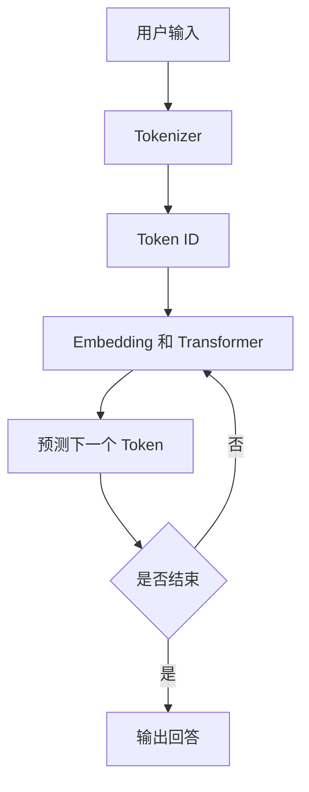
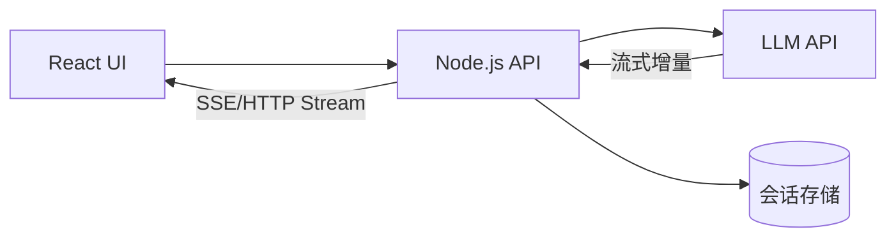

# 第 01 篇：ChatGPT 到底是如何回答问题的？

> 第一阶段 · 阅读约 8 分钟 · 前置知识：无

## 1. 从用户输入到模型回答

基础大语言模型不是直接在数据库里寻找一个现成答案，而是根据上下文逐步预测下一个 Token。



现代 ChatGPT 产品还可能加入搜索、工具调用、记忆等功能；产品不等于基础模型。

## 2. Token 是什么？

Token 是模型处理文本的基本单位，可能是字、词的一部分或标点。Tokenizer 将文本编码成 Token ID；ID 只是编号，不直接表示语义。

例如「我是一名前端开发工程师」可能切分为「我 / 是一名 / 前端 / 开发 / 工程师」，但具体结果依赖 Tokenizer。

## 3. 自回归生成

给定「JavaScript 是一种」，模型为下一个 Token 分配概率。选出「编程」后，再继续预测「语言」等。模型不一定每次选概率最高的 Token，Temperature 和 Top-p 会影响采样。

## 4. Transformer 和 Attention

Transformer 通过注意力机制利用上下文。例如「小明把电脑放在桌上，因为它太重了」，模型需要利用前面的词语判断「它」可能指什么。Attention 是可学习的向量计算机制，不等于人类意识或完整的因果解释。

## 5. 为什么模型会写代码？

训练使模型学习大量代码和语言模式，例如：

```ts
const sum = (a: number, b: number) => a + b
```

模型能生成看似合理的代码，但仍需测试、类型检查和人工审查。

## 6. 聊天应用的工程架构



React 负责聊天交互；Node.js 负责鉴权、构建 Messages、调用模型和存储记录；LLM 负责生成文本。

## 7. 复习

- LLM：语言建模与生成。
- Token：模型处理文本的单位。
- Tokenizer：文本与 Token ID 的编码解码。
- Transformer：现代 LLM 常用的神经网络架构。
- Attention：按学习到的权重聚合上下文信息。

**思考题：** 为什么模型可能自信地给出错误答案？提示：生成高概率文本不等于事实核验。

## 学习疑问与解答

暂无，后续持续补充。

[下一篇：Token 与 Embedding →](./02-token-and-embedding)
