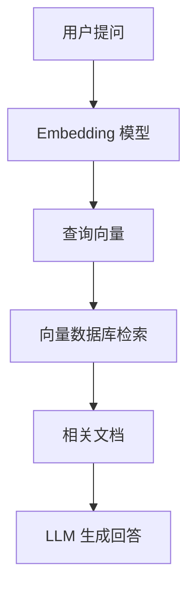

# 第 02 篇：Token 与 Embedding：为什么 AI 能把文字变成数学？

> 第一阶段 · 阅读约 10 分钟

## 1. Token ID 只是编号

Tokenizer 将文本拆成 Token，再编码为整数。Token ID 类似数据库主键，ID 接近不代表语义接近。

## 2. Embedding 是什么？

Embedding 将离散 ID 映射为连续向量。例如（仅示意）：

```text
苹果 → [0.82, 0.71, 0.13, ...]
香蕉 → [0.79, 0.75, 0.18, ...]
汽车 → [0.12, 0.09, 0.91, ...]
```

真实模型通常有数百至数千维；语义分布在多个维度中，不能认为某一维固定代表「水果」。

注意区分：LLM 内部的 **Token Embedding** 与专门用于语义检索的 **文本 Embedding 模型**。

## 3. 余弦相似度

$$
\operatorname{sim}(A,B)=\frac{A\cdot B}{\|A\|\|B\|}
$$

例如 A=(3,4)、B=(4,3)，相似度为 24/25=0.96。余弦相似度衡量非零向量方向的接近程度，不保证事实正确。

## 4. 高维向量与二维投影

Embedding 可能有 1536 维，常用 PCA 或 UMAP 降到二维展示。二维图可能丢失部分距离关系，不能仅凭图上两点靠近，就断定原始高维空间也同样接近。

## 5. RAG 中的 Embedding



真实系统通常还需要混合检索、重排序、引用溯源和评估。

## 6. TypeScript 实践

```ts
import OpenAI from 'openai'
const client = new OpenAI()

async function getEmbedding(text: string) {
  const result = await client.embeddings.create({
    model: 'text-embedding-3-small',
    input: text
  })
  return result.data[0].embedding
}

const vector = await getEmbedding('如何使用 React 管理状态？')
console.log(vector.length) // 默认 1536 维
```

查询和文档向量应使用兼容的模型及配置。

## 7. Token 成本

假设每百万输入 Token $1、输出 Token $4，一次请求输入 2000、输出 1000 Token，则成本为 $0.006；一万次约 $60。这是假设价格，并非实时定价。多轮对话重复发送历史消息，会增加输入 Token。

## 学习疑问与解答

### Q1（2026-10-15）：是不是不同方向的投影，就会有不同的语义？

**结论：要区分「向量方向」与「投影方向」。**

- 向量方向和相对位置在某些训练好的空间里可能反映语义关系，但没有保证每个方向对应一个固定的语义标签。
- 投影方向是观察高维向量的视角。改变投影可能突出不同的关系，但不会改变原始向量本身的语义表示。
- 降维可能损失信息：二维图中看似接近的点，在原始高维空间中未必同样接近。

**类比：** 三维物体从正面与侧面看轮廓不同，但物体并未变化。

**延伸问题：** 同一个「苹果」，为什么在「吃苹果」与「苹果发布 iPhone」中有不同的上下文含义？见第 03 篇。

## 复习题

1. Token ID 和 Embedding 有什么区别？
2. 余弦相似度为 1 是否意味着两句话事实相同？
3. 为什么二维投影不能完整反映高维空间？

[← 上一篇](./01-how-chatgpt-works) · [下一篇 →](./03-transformer-attention)
