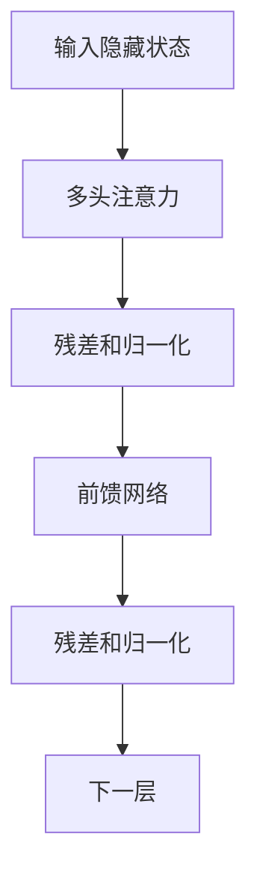

# 第 03 篇：Transformer 与 Attention：ChatGPT 为什么能理解上下文？

> 第一阶段 · 阅读约 12–15 分钟

## 1. 同一个词为什么有不同含义？

「我吃了苹果」和「苹果发布了 iPhone」里的「苹果」可能有相同的初始 Token Embedding，但经过 Transformer 后，会形成不同的上下文表示。

## 2. Self-Attention 的直觉

处理某个 Token 时，模型根据学习到的权重，从允许访问的其他位置聚合信息。例如「小明把电脑放在桌上，因为它太重了」，判断「它」的指代需要结合上下文。

注意力权重不是人工编写的语法规则，也不是对模型决策的完整解释。

## 3. Q、K、V

每个位置的隐藏状态 X 经可训练线性投影：

$$
Q=XW_Q,\quad K=XW_K,\quad V=XW_V
$$

- Query：寻找什么特征。
- Key：提供什么匹配特征。
- Value：被聚合的信息。

缩放点积注意力：

$$
\operatorname{Attention}(Q,K,V)=\operatorname{softmax}\left(\frac{QK^T}{\sqrt{d_k}}\right)V
$$

步骤：Q/K 点积 → 按维度缩放 → Softmax → 加权聚合 Value。

## 4. 手算一个小例子

假设注意力分数为 [1,2,3]，Softmax 约为 [0.09,0.245,0.665]。设三个 Value 分别是 [1,0]、[0,1]、[1,1]，输出约为 [0.755,0.910]。

这只是教学示意，省略了 Q/K 计算、掩码、残差等环节。

## 5. Multi-Head Attention

多个注意力头分别学习关联模式，再合并：

$$
\operatorname{MultiHead}(Q,K,V)=\operatorname{Concat}(head_1,\ldots,head_h)W_O
$$

不同头可能关注不同模式，但不能保证某个头固定负责「语法」或「地点」。

## 6. Causal Mask：不能偷看未来

GPT 类自回归模型通常只能关注当前及之前的 Token。

| 当前处理 | 我 | 喜欢 | 学习 | AI |
| --- | --- | --- | --- | --- |
| 我 | ✓ | × | × | × |
| 喜欢 | ✓ | ✓ | × | × |
| 学习 | ✓ | ✓ | ✓ | × |
| AI | ✓ | ✓ | ✓ | ✓ |

在注意力分数上对未来位置施加掩码，Softmax 后它们的权重接近零。生成回复时，用户已经输入的提示词属于已知上下文。

## 7. 位置编码

没有位置信息，模型难以区分「狗追猫」和「猫追狗」。不同架构采用绝对位置嵌入、相对位置表示、RoPE 等方式处理顺序。

## 8. Transformer Block



这是概念图，真实模型的归一化位置、前馈网络结构等存在差异。

## 9. 工程案例：流式输出

自回归解码逐步生成 Token，服务端可将增量结果通过 HTTP 流推送到前端。

```ts
// React/浏览器侧：消费服务端文本流（简化示例）
const response = await fetch('/api/chat', { method: 'POST' })
if (!response.ok || !response.body) throw new Error('Chat failed')

const reader = response.body.getReader()
const decoder = new TextDecoder()
let answer = ''

while (true) {
  const { done, value } = await reader.read()
  if (done) break
  answer += decoder.decode(value, { stream: true })
  console.log(answer) // 实际项目中更新 React 状态
}
answer += decoder.decode()
```

这个例子假设后端直接返回纯文本流；如果后端返回 SSE，需要额外解析事件边界和 data 字段。生产环境还需处理取消、超时、断线和错误。

## 10. 复习题

1. Q、K、V 分别负责什么？
2. 为什么需要除以根号 d_k？
3. 多头注意力有什么价值？
4. 为什么生成式模型需要因果掩码？
5. 流式输出与模型的自回归生成有什么关系？

## 学习疑问与解答

暂无，后续持续补充。

[← 上一篇](./02-token-and-embedding) · [返回目录](./index)
