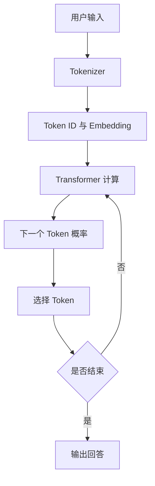
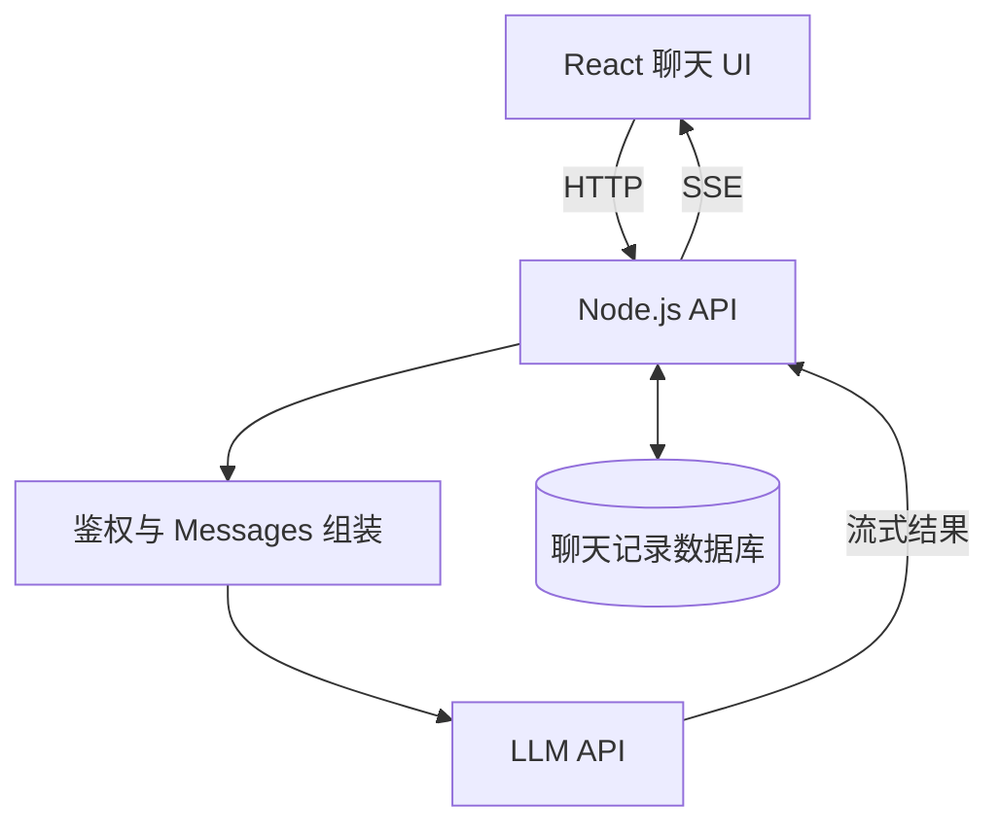

# 第 01 篇：ChatGPT 到底是如何回答问题的？

> 第一阶段：AI 与大模型基础｜阅读约 8 分钟

## 1. 从用户输入到模型回答

用户问「为什么 JavaScript 是单线程的？」基础语言模型不是直接查询固定答案，而是根据上下文逐步预测下一个 Token。



这种逐个生成的机制叫**自回归生成**。现代聊天产品还可能组合搜索、工具、记忆和安全策略，因此产品不等于基础模型。

## 2. Token 是什么？

Token 是模型处理文本的基本单位，不一定等于汉字或英文单词。

```text
输入：我是一名前端开发工程师
示意分词：["我","是一名","前端","开发","工程师"]
示意 ID：[123,456,789,234,567]
```

以上仅为教学示例，真实切分由 Tokenizer 决定。Token ID 是编号，不直接代表语义。

## 3. 为什么能逐字生成？

给定「JavaScript 是一种」，模型可能为后续 Token 计算以下**假设**概率：

| 候选 | 概率 |
| --- | ---: |
| 编程 | 65% |
| 脚本 | 20% |
| 动态 | 10% |
| 其他 | 5% |

选出「编程」后，模型再基于「JavaScript 是一种编程」预测后续 Token，直到结束。选择策略可能受 Temperature、Top-p 等参数影响，不一定每次都选最高概率。

## 4. Transformer 与 Attention

Transformer 是现代大语言模型广泛采用的架构。Attention 帮助模型在处理某个位置时利用上下文信息。

例如「小明把电脑放在桌子上，因为它太重了」中的「它」，需要参考其他词语来判断指代。Attention 是可学习的数值机制，不是硬编码的规则，也不能单独作为模型决策的完整解释。

## 5. 为什么模型会编程？

训练过程中模型学习了大量语言、代码结构和统计规律，因此可以生成：

```ts
const sum = (a: number, b: number) => a + b;
```

但**生成合理代码不代表代码一定正确**。工程上仍需要类型检查、测试和审查。

## 6. 从 React + Node.js 看聊天系统



LLM 负责内容生成，聊天应用还需要会话管理、鉴权、存储、流式输出、限流和安全机制。

## 7. 复习要点

- LLM：学习语言规律并生成 Token 的模型。
- Token：文本的基本处理单位。
- Tokenizer：将文本转换为 Token ID。
- Transformer：利用上下文处理序列的架构。
- Attention：按权重聚合不同位置的信息。

## 学习疑问与解答

目前暂无针对本篇的新问题，后续在此追加。

## 思考题

为什么模型可能给出语气自信但事实错误的回答？提示：预测下一个 Token 与验证事实真实性不是同一回事。

[下一篇：Token 与 Embedding →](./02-token-and-embedding)