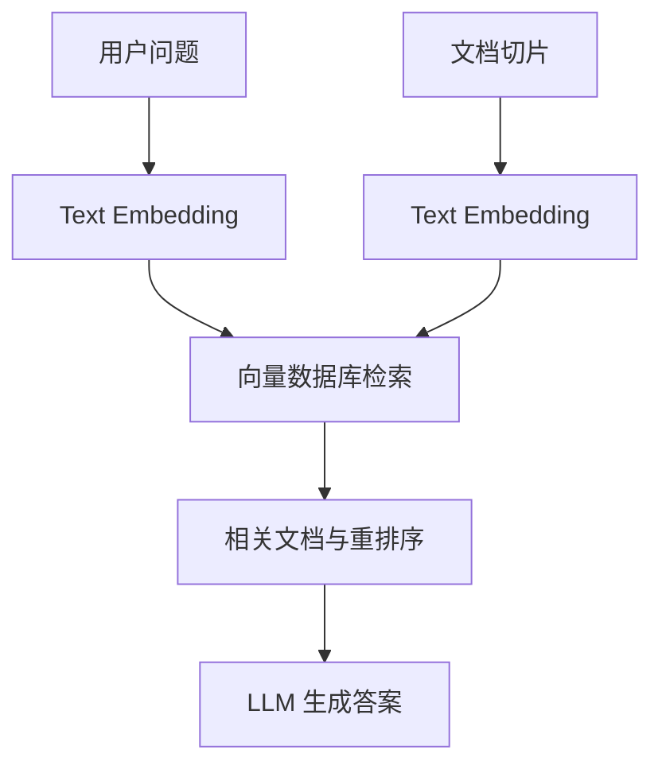
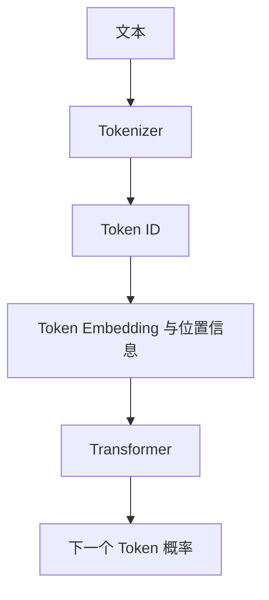

# 第 02 篇：Token 与 Embedding：为什么 AI 能把文字变成数学？

> 第一阶段：AI 与大模型基础｜阅读约 10 分钟

## 1. Token 与 Token ID

Tokenizer 将文本分成 Token，再编码为数字 ID。Token 不等于汉字数或单词数。

```text
文本：我是一名前端开发工程师
示意 Token：我 / 是一名 / 前端 / 开发 / 工程师
示意 ID：123 / 456 / 789 / 234 / 567
```

这些 ID 只是编号，不能靠大小判断词义。

## 2. Embedding 是什么？

Embedding 将离散的 Token ID 映射为连续的高维向量。

```text
苹果 → [0.82, 0.71, 0.13, ...]
香蕉 → [0.79, 0.75, 0.18, ...]
汽车 → [0.12, 0.09, 0.91, ...]
```

以上向量为教学假设。真实向量可能包含数百至数千维，单个维度通常不具有固定的人类语义标签。

需要区分：

- **Token Embedding**：LLM 内部将 Token ID 映射为初始表示，随模型训练一起优化。
- **Text Embedding**：将句子或文档编码为便于语义检索的向量，通常经过专门训练。

## 3. 为什么向量可以表示语义？

语义 Embedding 模型通常让相关文本拥有较高的相似度，例如「React 如何管理状态」与「React 状态管理怎么做」。这来自训练而非人工编写的水果、汽车等分类规则。

**二维投影只是可视化，不代表真实模型只有两个语义维度。**

## 4. 余弦相似度

```math
\operatorname{sim}(A,B)=\frac{A\cdot B}{\|A\|\|B\|}
```

非零向量的余弦相似度范围为 -1 到 1。越接近 1，方向越一致，但不保证事实正确。

```ts
function cosine(a: number[], b: number[]): number {
  if (!a.length || a.length !== b.length) throw Error("维度不一致");
  const dot = a.reduce((sum, x, i) => sum + x * b[i], 0);
  const na = Math.sqrt(a.reduce((s, x) => s + x * x, 0));
  const nb = Math.sqrt(b.reduce((s, x) => s + x * x, 0));
  if (!na || !nb) throw Error("零向量不可计算");
  return dot / (na * nb);
}
```

## 5. 工程案例：Embedding API 与 RAG

```ts
import OpenAI from "openai";
const client = new OpenAI();

async function embed(text: string) {
  const response = await client.embeddings.create({
    model: "text-embedding-3-small",
    input: text,
  });
  return response.data[0].embedding;
}

const vector = await embed("如何使用 React 管理状态？");
console.log(vector.length); // 默认 1536
```



普通聊天通常不必单独调用 Text Embedding API；模型服务内部已经完成 Token Embedding。

## 6. Token 成本

假设输入价格为每百万 Token $1、输出为 $4，每次输入 2000 Token、输出 1000 Token，调用 10000 次：

- 输入：$20
- 输出：$40
- 合计：$60

这是假设价格，并非实时定价。多轮聊天若重复传入历史消息，会增加输入 Token 用量。

## 7. Embedding 与 Transformer 的关系



Embedding 提供初始向量，Transformer 结合上下文更新隐藏表示，因此「吃苹果」和「苹果发布 iPhone」中的同一个 Token 可以产生不同的上下文表示。

## 学习疑问与解答

### Q1：是不是不同方向的投影，就会有不同的语义？

**提问日期：2026-10-15**

**结论：需要区分「向量方向」与「投影方向」。**

- 原始向量的方向和位置可能编码语义关系，但语义通常分布在多个维度中，不存在固定的「水果轴」「汽车轴」。
- 将高维向量投影到二维，只是改变观察角度，**不会改变原始向量**。
- 不同投影可能突出不同关系，也可能丢失信息。因此二维图中靠近，不保证原始高维空间中同样靠近。

**复习类比：** 一个三维物体从正面和侧面看轮廓不同，但物体本身并没有改变。

## 复习题

1. Token ID 与 Embedding 的区别是什么？
2. 普通聊天为什么通常不需要单独调用 Embedding API？
3. 余弦相似度高是否能证明答案正确？
4. 同一个词在不同上下文中为什么会有不同表示？

[← 上一篇](./01-how-chatgpt-works) · [下一篇 →](./03-transformer-attention)