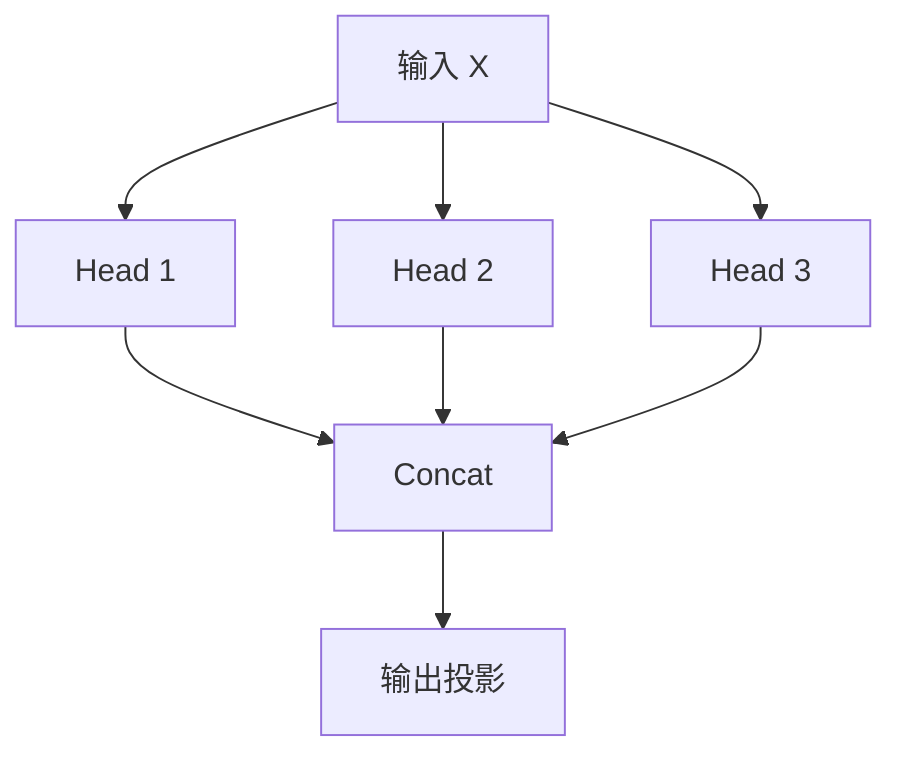
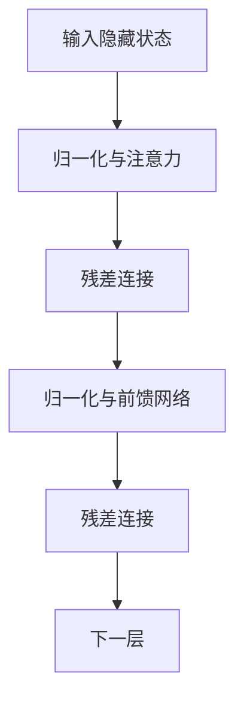

# 第 03 篇：Transformer 与 Attention：ChatGPT 为什么能理解上下文？

> 第一阶段：AI 与大模型基础｜阅读约 12–15 分钟

<script setup>
import AiCourseLab from '../../../.vitepress/theme/components/AiCourseLab.vue'
</script>

## 1. 为什么仅有 Embedding 不够？

比较「我今天吃了一个苹果」与「苹果发布了新款 iPhone」。如果「苹果」对应相同 Token ID，初始 Token Embedding 相同，但语境不同。

Transformer 通过上下文计算，让 Token 的隐藏状态随语境变化。这里的「理解」指学习有效的上下文表示，不等同于人类的主观理解。

## 2. Self-Attention 是什么？

Self-Attention 让一个 Token 在计算新表示时，从序列中其他允许访问的位置聚合信息。

例如「小明把电脑放在桌子上，因为它太重了」，处理「它」时需要利用「电脑」「桌子」「太重了」等上下文。

注意力权重不等于模型推理的完整解释，模型还有多层网络和其他变换。

<AiCourseLab type="attention" />

## 3. Q、K、V 的含义

| 名称 | 全称 | 直观理解 |
| --- | --- | --- |
| Q | Query | 我需要匹配什么信息 |
| K | Key | 我提供什么匹配特征 |
| V | Value | 匹配后我提供什么内容 |

输入隐藏状态矩阵 X 经过三组可训练线性变换：

$$
Q=XW_Q,\quad K=XW_K,\quad V=XW_V
$$

## 4. Attention 的公式

$$
\operatorname{Attention}(Q,K,V)=\operatorname{softmax}\left(\frac{QK^T}{\sqrt{d_k}}\right)V
$$

四步理解：

1. QKᵀ 计算匹配分数。
2. 除以 √dₖ 进行缩放，改善数值稳定性。
3. Softmax 将分数变为总和为 1 的权重。
4. 用权重对 V 加权求和，形成聚合信息。

### 手算示例

假设已缩放分数为 [1,2,3]，Softmax 约为 [0.09,0.245,0.665]。

若 V₁=[1,0]、V₂=[0,1]、V₃=[1,1]，加权和为：

```text
0.09×[1,0] + 0.245×[0,1] + 0.665×[1,1]
= [0.755, 0.910]
```

这是不带因果约束的教学示例；GPT 类模型的首位置不能直接关注后续 Token。

## 5. Multi-Head Attention

多个注意力头各自拥有投影参数，能够学习不同的关联模式，输出拼接后再经线性投影：

$$
\operatorname{MultiHead}=\operatorname{Concat}(head_1,\ldots,head_h)W_O
$$

不同头不一定有明确固定的语法或语义标签。



## 6. Causal Mask：为什么不能看到未来？

GPT 类自回归模型通常使用因果掩码，当前位置只能关注自身和之前的位置。

例如序列「我 / 喜欢 / 学习 / AI」：

| 当前 Token | 我 | 喜欢 | 学习 | AI |
| --- | :---: | :---: | :---: | :---: |
| 我 | ✓ | × | × | × |
| 喜欢 | ✓ | ✓ | × | × |
| 学习 | ✓ | ✓ | ✓ | × |
| AI | ✓ | ✓ | ✓ | ✓ |

未来位置的分数在 Softmax 前被屏蔽。**生成时不会偷看尚未生成的答案**。

<AiCourseLab type="mask" />

## 7. Transformer Block 还有什么？

除了注意力，经典 Transformer Block 还包含前馈网络（FFN）、残差连接、归一化等组件。不同现代模型对组件顺序和细节有不同设计。



## 8. TypeScript 工程思考

构建 React + Node.js 聊天机器人时，通常**不需要手写 Attention**，而是通过 LLM API 使用已经训练好的模型。工程重点是消息组织、上下文裁剪、流式输出、RAG 与评估。

一个重要区别：**Self-Attention 是模型内部机制；聊天历史管理是应用层职责**。应用必须把需要的历史消息传给模型，模型才可能利用它们。

## 学习疑问与解答

### Q1：Self-Attention 是否根据上下文动态赋予每个 Token 对应的语义？

**提问日期：2026-10-15**

**简答：基本正确，但更准确地说，它会根据上下文动态聚合信息并更新 Token 的向量表示，而不是直接分配一个新的语义标签。**

- 相同 Token ID 通常对应相同的初始 Token Embedding，但进入不同上下文后，隐藏状态可以不同。
- Self-Attention 使用 Query 与 Key 计算注意力权重，再对 Value 向量加权聚合；随后结合残差连接、前馈网络等形成新的隐藏状态。
- 多层 Transformer 共同形成上下文相关的语义表示，而不只是单个注意力头的作用。
- **因果注意力限制**：GPT 类模型的当前位置只能关注自身及之前的 Token。例如「苹果今天发布 iPhone」中，句首的「苹果」不能直接看到后面的「iPhone」；后续位置可以利用先前信息。

**复习要点：Self-Attention 动态更新的是表示，不是直接为 Token 打语义标签；注意 GPT 的因果掩码。**


## 复习题

1. 为什么同一个 Token 可以在不同句子中形成不同表示？
2. Q、K、V 分别承担什么职责？
3. Softmax 后的权重有什么性质？
4. 为什么 GPT 需要 Causal Mask？
5. Attention 和应用层的聊天记忆有什么区别？

[← 上一篇：Token 与 Embedding](./02-token-and-embedding)